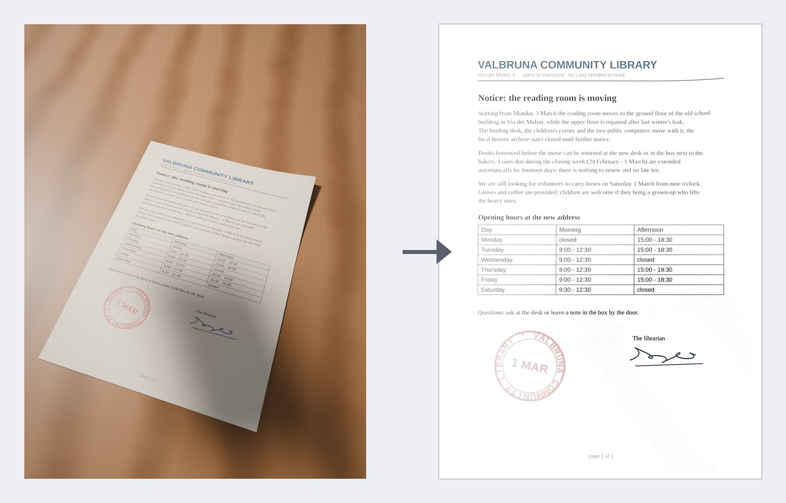
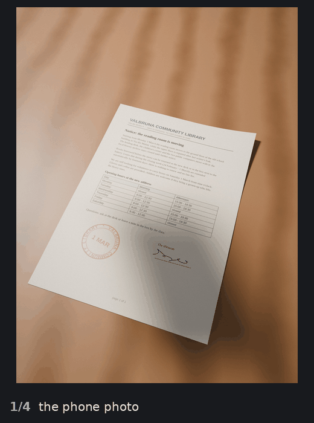
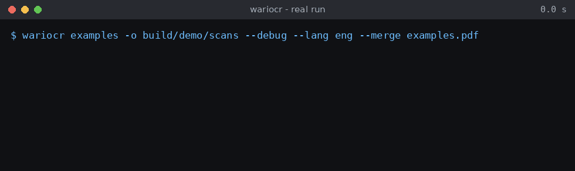

# wariOCR

Turn phone photos of paper documents into true-scale, clean A4 PDFs, with an optional
searchable text layer.



*Left: the input photo. Right: the page the `wariocr` command wrote from it, unretouched.
The photo is a synthetic demo (see [docs/media/SOURCES.md](docs/media/SOURCES.md)); the
output is real.*

I wrote this because the scanner apps I tried either needed a cloud account, cropped the
page wrong as soon as the sheet was curled or partly out of the frame, or produced PDFs at
whatever size the photo happened to be. I wanted a batch tool: a folder of photos in, one
PDF per page out, each page exactly 210 x 297 mm so it prints at 100% and the scale is real.

## What it does



For each photo:

1. **Finds the sheet outline** — edge lines, paper-likeness (bright, low saturation) and
   contour candidates are scored together, so a white sheet on a light desk still works.
   Sides that run out of the frame are allowed.
2. **Recovers the camera pose** from vanishing points and rectifies the sheet to its true
   proportions, not just "whatever quadrilateral was found". If a side of the page is
   outside the photo, it is rebuilt from the paper format (A4 by default) and marked in
   light grey instead of being invented.
3. **Cleans the page**: removes JPEG noise, flattens uneven light and shadows, pushes the
   paper to white, keeps coloured ink (stamps, signatures, highlighter) in colour, sharpens
   only the lightness channel, and fixes small residual skew.
4. **Fixes orientation** with Tesseract's orientation detection, if Tesseract is installed.
5. **Writes a PDF per photo** at the true paper size (A4, A5, Letter, Legal), optionally a
   merged PDF in the order you choose, and optionally runs [OCRmyPDF] to add a text layer
   without re-compressing the images.

Photos are processed in parallel, one process per core.



## Install

Python 3.10 or newer. From a clone of this repository:

```sh
python3 -m venv .venv
. .venv/bin/activate
pip install .            # core: OpenCV, NumPy, Pillow, img2pdf
pip install '.[ocr]'     # + OCRmyPDF for the searchable text layer
pip install '.[heif]'    # + HEIC/HEIF photos (iPhone default format)
```

OCR and automatic page orientation also need system packages, which pip cannot install:

- [Tesseract] with the language data you need (`eng`, `ita`, ...) and `osd` for
  orientation detection;
- Ghostscript, required by OCRmyPDF.

On Arch: `pacman -S tesseract tesseract-data-eng tesseract-data-osd ghostscript`.
On Debian/Ubuntu: `apt install tesseract-ocr tesseract-ocr-eng ghostscript`.
On macOS: `brew install tesseract ghostscript`.

Without them wariOCR still works; it prints a warning and writes PDFs without text.

## Usage

```sh
wariocr photos/                         # -> photos/scans/*.pdf, one per photo
wariocr photos/ -o out/ --merge all.pdf # also one merged PDF
wariocr photos/ --lang eng+deu          # Tesseract languages (default ita+eng)
wariocr photos/ --mode bw               # 1-bit pages, smallest files
wariocr photos/ --mode gray --pdfa      # greyscale, PDF/A for archiving
wariocr photos/ --paper letter          # or a5, legal, none (keep the photo's scale)
wariocr photos/ --order order.txt       # page order of the merged PDF, one name per line
```

The cleaned page images are kept in `OUT/pages/` for touch-ups. `wariocr --help` lists the
remaining knobs (`--dpi`, `--denoise`, `--whiten`, `--saturation`, `--jpeg-quality`,
`--jobs`).

### When the outline is wrong

Run with `--debug`: every photo gets `OUT/debug/NAME_detect.jpg` with the detected outline
in red. Open the wrong ones in an image editor, draw the sheet outline in pure blue
(`#0000FF`) — a side may be left undrawn where the sheet leaves the photo — and save the
image, keeping its file name, into `photos/corners/`. The next run uses your outline for that photo and prints
`MANUAL` next to it.

### As a library

```python
import wariocr

r = wariocr.process("photo.jpg", "out/", mode="color", dpi=300, paper="a4")
print(r.out, r.detected, r.angle)   # page image path, outline found?, deskew degrees
```

## How well it works

Measured on my laptop (Ryzen 7 5700U, 4 hardware threads reserved for the run, Python 3.14), with the
two 2268 x 3024 demo photos, one process (`--jobs 1`), median of three runs:

| | per photo |
|---|---|
| photo -> cleaned A4 page at 300 dpi, PDF (`--no-ocr`) | ~10 s |
| the same plus OCR (`--lang eng`, Tesseract 5.5 via OCRmyPDF 17) | ~16 s |

With the default `--jobs` (one per core) a folder of photos goes through in parallel. A
colour A4 page at 300 dpi is ~0.75 MB as a PDF; `--mode bw` is much smaller.

On my own set of 20 real phone photos of documents (not published: they are private papers),
the detected outline overlaps a hand-drawn one with a mean IoU of 0.94 (worst photo 0.76).
That is the honest state: most pages come out right, and the ones that don't are why the
manual outline exists.

The two demo photos show both sides. `notice-1` (hero image above) was folded in three, has a curled
corner and the phone's shadow across the signature; the page comes out flat and white.
`notice-2` (second half of the animation) is harder: the top-left corner is outside the
photo and the right edge is lifted like a book page. The missing corner is rebuilt as
light grey paper (`rebuilt 6%` in the output), and the curl leaves the header rule and the
table slightly bent — see Limits.

## Limits

Things it does not do (yet), so you don't waste time finding out:

- **One sheet per photo.** Two pages of an open book, or several receipts on a table, are
  treated as one document.
- **Curl is handled by the pose, not by a page model.** Gentle curl and folds come out
  fine; a thick bound book with a strongly curved page near the spine will still show
  bent lines.
- **No neural networks.** Detection is classical computer vision. A sheet that has almost
  no contrast with the background (white paper on a white tablecloth, no shadow) can fail;
  the photo is then kept whole and listed at the end as "outline NOT found". The manual
  outline above is the way out.
- **Paper size is not inferred.** Default is A4; use `--paper` for others or `none` to keep
  the photo's own scale (receipts, cards).
- **Glare is not removed.** A specular highlight on glossy paper stays a washed-out area.
- Python and OpenCV, so it is a command-line tool for a computer, not a phone app.

## Development

```sh
pip install -e '.[dev]'
pytest -q
ruff check wariocr tests tools
```

The tests build synthetic document photos with known geometry (`tests/synth.py`), so they
need no image files. The README media are rebuilt with `tools/demo/make_photos.sh` (needs
Blender) and `python tools/demo/media.py`.

## License

Copyright (C) 2026 BiNeurale (Emanuele Lovato).

wariOCR is free software: you can redistribute it and/or modify it under the terms of the
GNU Affero General Public License as published by the Free Software Foundation, either
version 3 of the License, or (at your option) any later version. See [LICENSE](LICENSE).
Contributions are welcome under the terms in [CONTRIBUTING.md](CONTRIBUTING.md).

[OCRmyPDF]: https://github.com/ocrmypdf/OCRmyPDF
[Tesseract]: https://github.com/tesseract-ocr/tesseract
